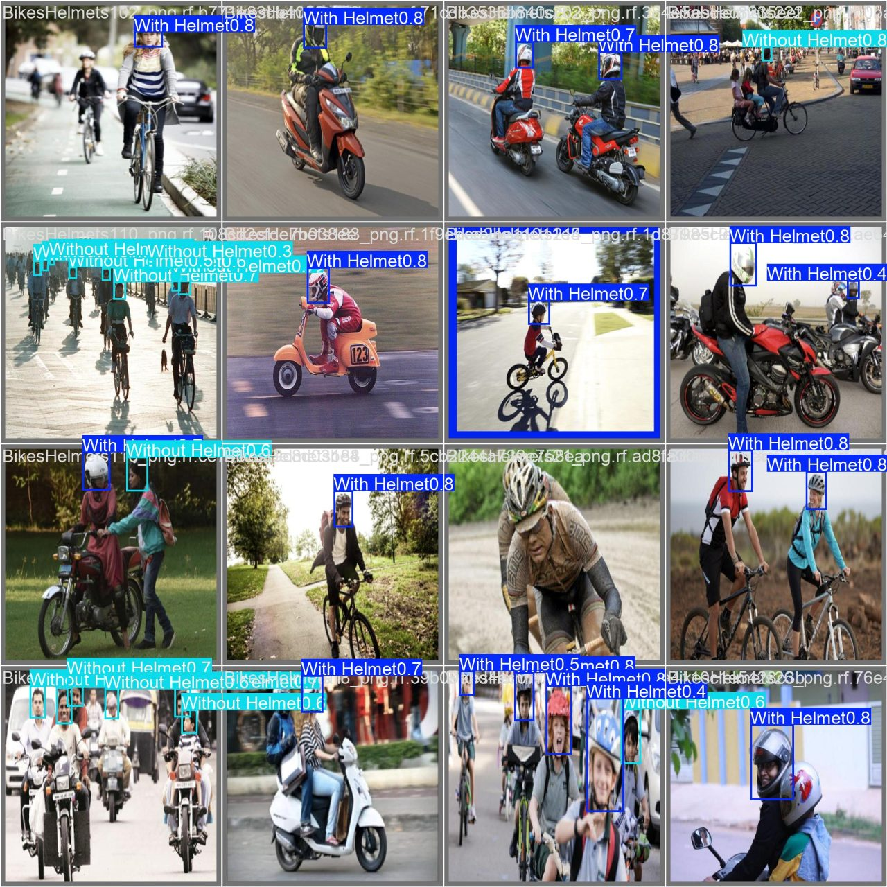
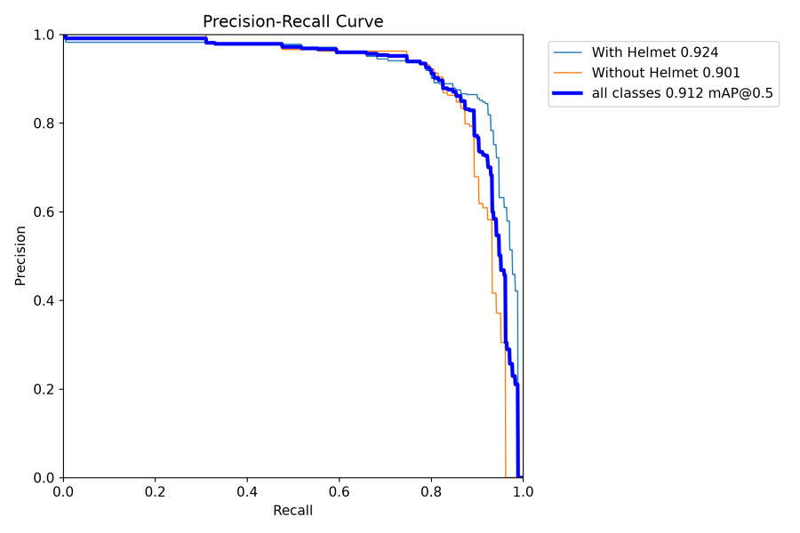
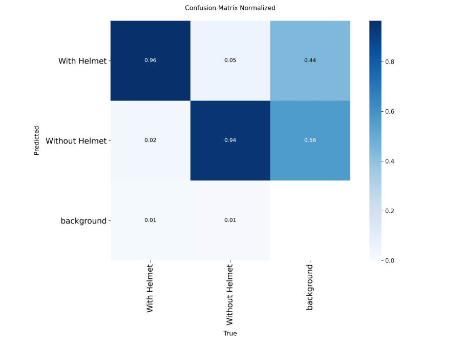

# 🪖 Smart Helmet Detection

[](https://smart-helmet.streamlit.app)


ระบบตรวจจับการสวมหมวกกันน็อคของผู้ขับขี่จากรูปภาพและวิดีโอ — วิชา Image Processing and Computer Vision

**ลองใช้งาน:** https://smart-helmet.streamlit.app



## ความสามารถ

- **รูปภาพ:** ตรวจจับหัวผู้ขับขี่ แยก `With Helmet` / `Without Helmet` วาดกรอบ สรุปจำนวน อัตราการสวมหมวก ตาราง และดาวน์โหลดรูปผลลัพธ์
- **วิดีโอ:** ตรวจ ~5 เฟรม/วินาที + ติดตามแต่ละคนด้วย ByteTrack (นับคนไม่ซ้ำ) กราฟจำนวนคนตามเวลา และดาวน์โหลดวิดีโอผลลัพธ์
- ปรับ Confidence threshold ได้ใน "ตั้งค่าขั้นสูง" (ค่าเริ่มต้น 0.3 = ค่าที่ F1 สูงสุดบน valid set)

## วิธีการ

```
รูป/เฟรมวิดีโอ → YOLO11n (one-stage object detector, anchor-free) → bounding box + คลาส + confidence
              → กรองด้วย confidence threshold → (วิดีโอ) ByteTrack ให้ ID ต่อคน → สรุปผล
```

- Transfer learning จาก `yolo11n.pt` (pretrained บน COCO) แล้ว fine-tune 2 คลาส
- ตรวจจับเฉพาะ **หัว** ของผู้ขับขี่ ไม่ใช่ทั้งตัว — หมวกทั่วไป (เช่นหมวกแก๊ป) นับเป็น `Without Helmet`

## Dataset

[Helmet Detection_YOLOv8 v3](https://universe.roboflow.com/learning-evidence/helmet-detection_yolov8) (CC BY 4.0) — 2 คลาส `With Helmet`, `Without Helmet`

| ส่วน | จำนวนรูป |
|---|---|
| train | 3,648 (จากรูปต้นฉบับ 1,737 รูป + augmentation ×3 ของ Roboflow) |
| valid | 372 |
| test | 149 |

Preprocessing จาก Roboflow: Auto-Orient, Resize 640×640 · Augmentation: Flip, Crop, Grayscale, Hue/Saturation/Brightness, Blur

## โมเดลและผลประเมิน (test set 149 รูป, RTX 5060)

| โมเดล | พารามิเตอร์ | epochs (best) | mAP50 | mAP50-95 | Precision | Recall | F1 สูงสุด | ms/รูป (GPU) | ขนาด |
|---|---|---|---|---|---|---|---|---|---|
| **yolo11n** (ใช้ในแอป) | **2.6 M** | 50 (37) | 0.912 | **0.596** | 0.852 | **0.879** | **0.870** | **3.2** | **5.5 MB** |
| yolo11s | 9.4 M | 50 (30) | 0.896 | 0.575 | 0.846 | 0.845 | 0.848 | 7.8 | 19.2 MB |
| yolo11m | 20.1 M | 60 (42) | **0.917** | 0.574 | **0.874** | 0.847 | 0.865 | 10.9 | 40.5 MB |

โมเดลใหญ่ไม่ได้ให้ผลดีกว่าอย่างมีนัยสำคัญกับ dataset ขนาดนี้ (train ครั้งเดียวต่อโมเดล) yolo11n ให้ mAP50-95 และ F1 สูงสุด และเร็วที่สุด เหมาะกับ Streamlit Cloud ที่รันบน CPU จึงเลือกใช้ในแอป

<p>
  
  
</p>

## รันแอปในเครื่อง

```bash
pip install -r streamlit_app/requirements.txt
streamlit run streamlit_app/app.py
```

Deploy: Streamlit Community Cloud → main file `streamlit_app/app.py` (push เข้า `main` แล้วแอปอัปเดตเอง)

## Train โมเดลใหม่ (GPU ในเครื่อง, ตั้งค่าสำหรับ RTX 5060 8 GB)

```bash
pip install torch torchvision --index-url https://download.pytorch.org/whl/cu128
pip install -r training/requirements.txt
python training/train.py                         # yolo11n
python training/train.py --model yolo11s.pt      # โมเดลอื่น
```

- ครั้งแรกจะขอ Roboflow API key เพื่อดาวน์โหลด dataset
- ผลลัพธ์อยู่ที่ `~/helmet-detection/`: `best_<โมเดล>.pt`, กราฟใน `runs/<โมเดล>/`, ตารางเทียบ `results_summary.csv`
- ถ้าเจอ `CUDA out of memory` ใช้ `--batch 8`
- ใช้โมเดลใหม่ในแอป: copy `best_<โมเดล>.pt` ไปทับ `streamlit_app/best.pt`

## โครงสร้าง

```
streamlit_app/   แอป Streamlit + best.pt (yolo11n)
training/        script สำหรับ train และประเมินผล
docs/            รูปผลลัพธ์ใน README
packages.txt     แพ็กเกจระบบสำหรับ Streamlit Cloud
```
